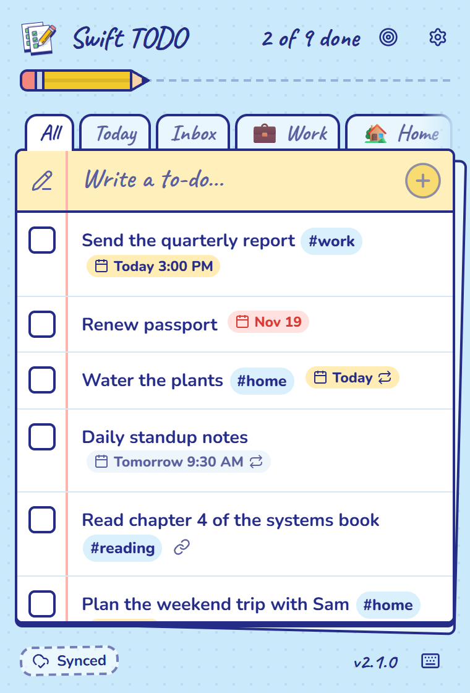

<p align="center">
  
</p>

<h1 align="center">Swift TODO</h1>
<p align="center">A quick to-do list in your browser toolbar, synced with your browser account.</p>
<p align="center"><a href="https://swift-todo.ouss.es"><strong>swift-todo.ouss.es</strong></a> · <a href="https://to.ouss.es/swift-todo/trailer">Watch the trailer</a></p>

<p align="center">
    <a href="https://github.com/eoussama/swift-todo/actions/workflows/ci.yml" target="_blank"></a>
    <a href="https://github.com/eoussama/swift-todo/releases" target="_blank"></a>
    <a href="https://github.com/eoussama/swift-todo/blob/master/LICENSE" target="_blank"></a>
    
</p>

## Description

Swift TODO is a browser extension for jotting down things to do on the fly. Click the toolbar icon (or press <kbd>Alt</kbd>+<kbd>Shift</kbd>+<kbd>L</kbd>), type, press <kbd>Enter</kbd>, and get back to what you were doing. You can change that shortcut in `chrome://extensions/shortcuts`, `edge://extensions/shortcuts`, or in Firefox under *Add-ons and themes* → ⚙ → *Manage Extension Shortcuts*.

- Add, edit, check off, reorder and delete to-dos, with undo.
- Sort them into lists, and tag them with `#words`.
- Give them dates and repeats by typing naturally ("call Sam tomorrow 3pm", "water plants every 3 days"), with optional reminders and a toolbar badge for what's due.
- A Today view, and a focus mode with a timer, one to-do at a time.
- Add selected text from any page with a right-click, linked back to the page.
- Export to JSON, Markdown or CSV, and import a backup.
- Six skins (Notepad, Sticky board, Chalkboard, Scroll, Minimal and Aurora), each in light and dark, with eight accent colors, and to-dos written in each skin's own hand.
- Synced across your devices through your browser account, with no sign-up and no server of ours.
- No limit on the number of to-dos. Browser sync holds a few hundred; past that, new to-dos are kept on the device, and you choose which ones stay synced. When sync isn't available, everything is kept on the device.
- Fully usable from the keyboard and with screen readers.

See it in action in the **[showcase](showcase/showcase.md)**.

<p align="center">
  
</p>

Works in **Chrome**, **Edge** and **Firefox** (140 or later). Swift TODO collects no data; see the [privacy policy](https://swift-todo.ouss.es/privacy/).

## Installation

Get it from your browser's store:

- [Chrome Web Store](https://to.ouss.es/swift-todo/chrome) (also for Brave, Vivaldi and Opera)
- [Microsoft Edge Add-ons](https://to.ouss.es/swift-todo/edge)
- [Firefox Add-ons](https://to.ouss.es/swift-todo/firefox) (Firefox 140 or later)

To try a build before it reaches the stores, download the zip for your browser from the [latest release](https://github.com/eoussama/swift-todo/releases) and load it:

- **Chrome / Edge**: unzip it, open `chrome://extensions` (or `edge://extensions`), turn on *Developer mode*, then click *Load unpacked* and pick the unzipped folder.
- **Firefox**: open `about:debugging#/runtime/this-firefox`, click *Load Temporary Add-on…* and pick the zip.

## Development

Requires Node.js 24 or later and pnpm 12.

```bash
git clone https://github.com/eoussama/swift-todo.git
cd swift-todo
pnpm install
pnpm dev            # Chrome, with hot reload
pnpm dev:edge       # Edge
pnpm dev:firefox    # Firefox
```

### Scripts

- `pnpm check` – Run every check: dependency audit, lint, type check, unit tests with 100% coverage required, builds for all browsers, Mozilla's add-on linter, the end-to-end tests and the website's tests
- `pnpm build` / `build:edge` / `build:firefox` / `build:all` – Build the extension into `.output/`
- `pnpm zip` / `zip:edge` / `zip:firefox` / `zip:all` – Build and package store-ready zips
- `pnpm lint` – Lint the codebase with [@eoussama/dx](https://github.com/eoussama/dx)
- `pnpm fix` – Lint and auto-fix issues
- `pnpm lint:firefox` – Run Mozilla's add-on linter on the Firefox build
- `pnpm typecheck` – Type check the codebase, Svelte components included
- `pnpm test` – Run the unit tests (`test:watch` to rerun them on changes, `test:coverage` for a coverage report)
- `pnpm test:e2e` – Build the Chrome extension and run the end-to-end tests on it in Chromium, accessibility checks included (run `pnpm exec playwright install chromium` once first)
- `pnpm test:mutation` – Mutation testing with [Stryker](https://stryker-mutator.io) over the logic in `src/lib` (not the components), which checks that the unit tests catch every change to the code; it takes a few minutes, so it runs on its own rather than in `pnpm check` or CI (report in `reports/mutation/index.html`)
- `pnpm showcase` – Build the Chrome extension and retake the screenshots in [`showcase/`](showcase/showcase.md) with sample to-dos
- `pnpm branding` – Redraw the store images in [`branding/`](branding/README.md) from the showcase screenshots
- `pnpm site` – Work on the website ([`site/`](site/)) with hot reload; `site:build` builds it into `.output/site`, `site:preview` serves the build, `test:site` builds and tests it (see [docs/website.md](docs/website.md))

### Releasing

1. Update `version` in `package.json` and add a section for it to [CHANGELOG.md](CHANGELOG.md).
2. Commit, then tag and push: `git tag v2.1.1 && git push origin master v2.1.1`.
3. The [release workflow](.github/workflows/release.yml) runs every check, builds the Chrome, Edge and Firefox zips (plus the sources zip Firefox reviewers ask for) in a job that can only read the repository, then a separate job, the only one allowed to write, publishes them in a GitHub release with the changelog section as its notes. The [website workflow](.github/workflows/website.yml) deploys [swift-todo.ouss.es](https://swift-todo.ouss.es) from the same tag.
4. Upload the zips to the stores. The listing text is in [docs/store-listing.md](docs/store-listing.md).

### Stack

[WXT](https://wxt.dev), [Svelte 5](https://svelte.dev), [Tailwind CSS 4](https://tailwindcss.com), [shadcn-svelte](https://shadcn-svelte.com) on [Bits UI](https://bits-ui.com), [@eoussama/core](https://github.com/eoussama/core), [Vitest](https://vitest.dev) and [Playwright](https://playwright.dev).

## Contributing

Contributions are welcome. Please read the [contributing guidelines](CONTRIBUTING.md) and the [code of conduct](CODE_OF_CONDUCT.md) first, and report security issues as described in the [security policy](SECURITY.md).

## Support

Swift TODO is free, with no ads and no paid tier. If it saves you time, you can [leave a tip](https://to.ouss.es/tip).

## License

This project is licensed under the MIT License - see the [LICENSE](LICENSE) file for details.
