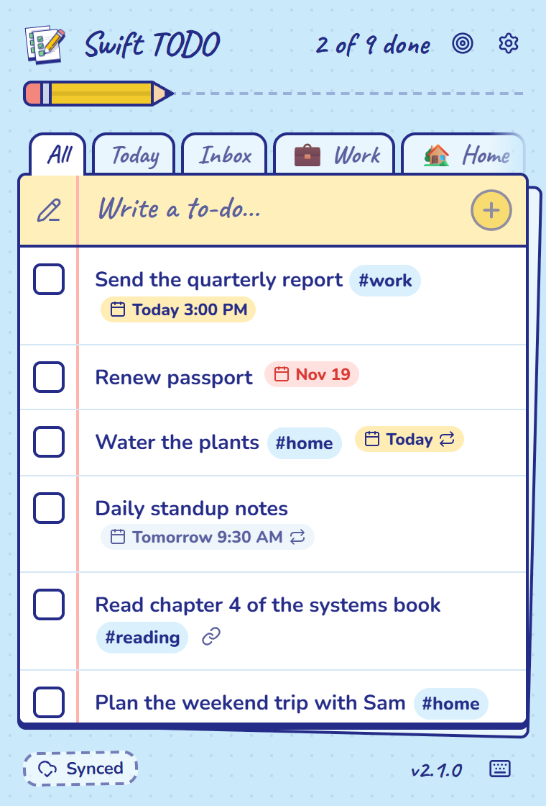
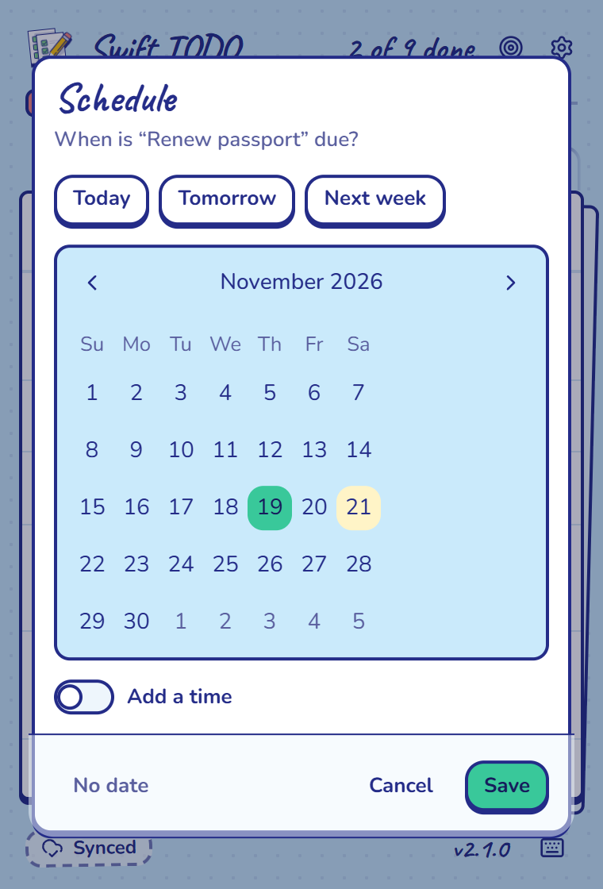
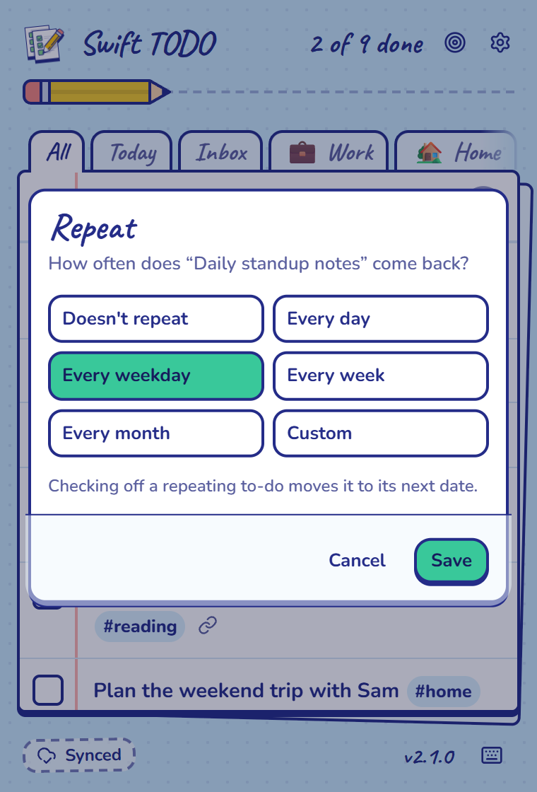
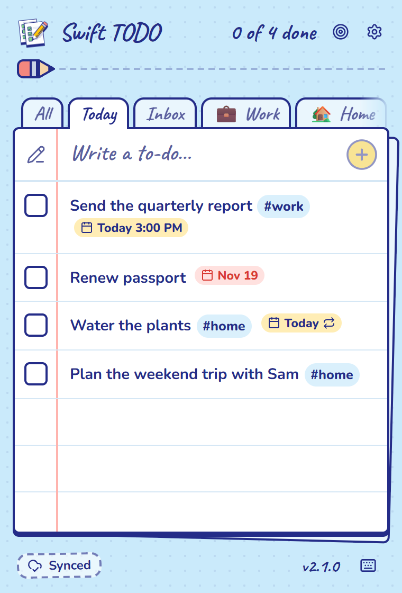
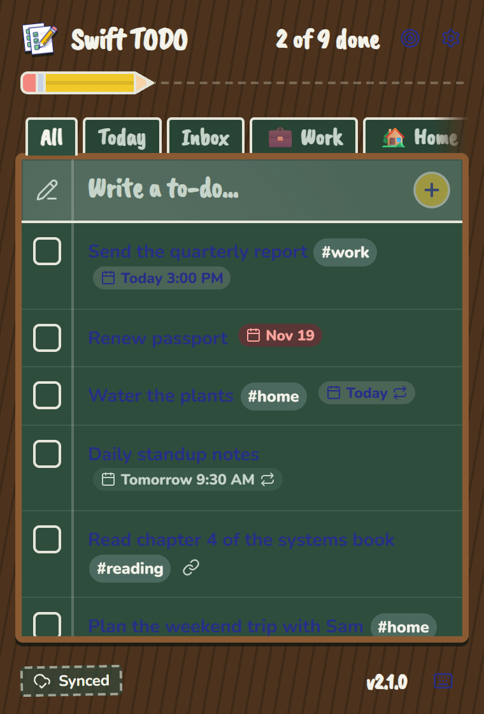
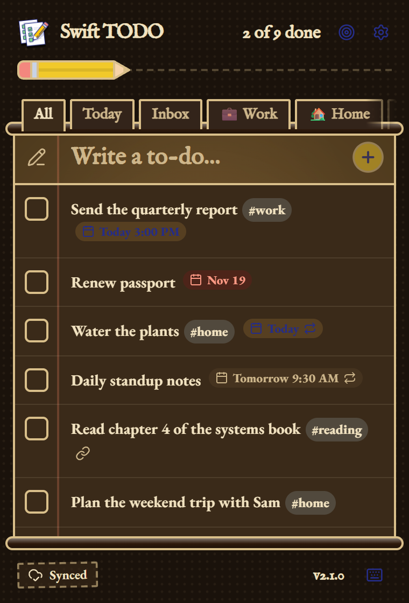
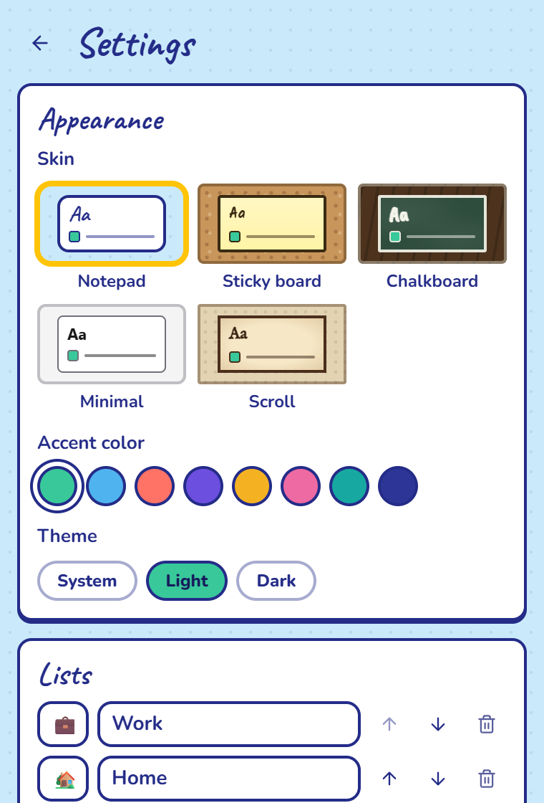
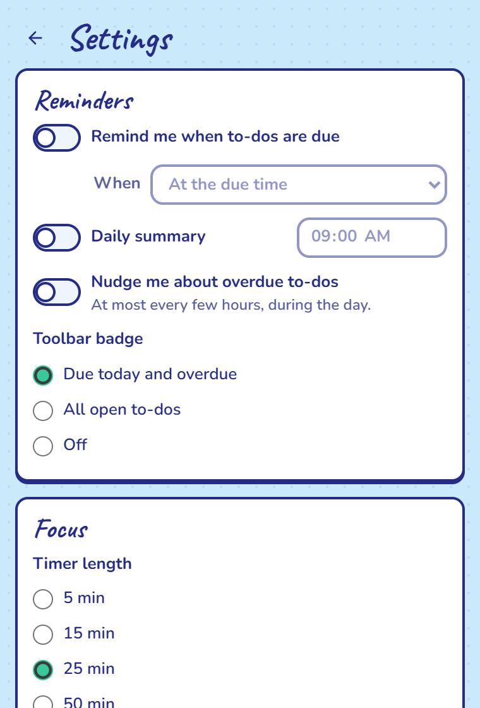
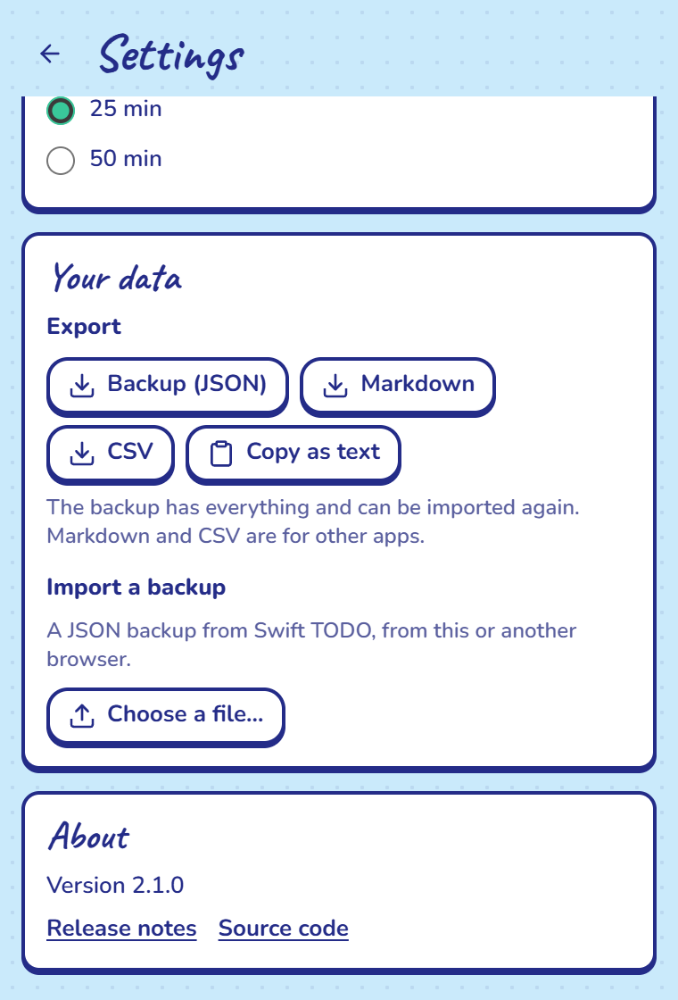
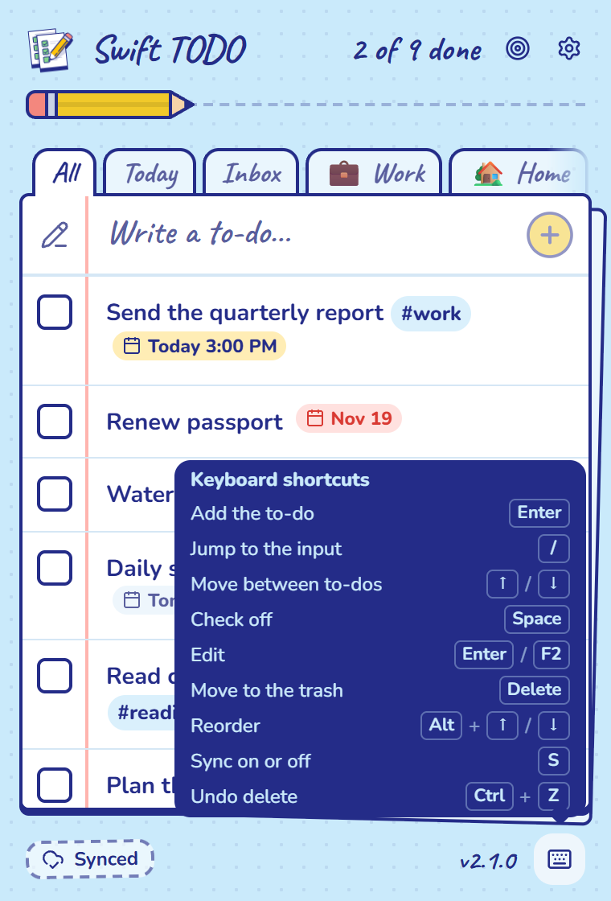

# Swift TODO showcase

A tour of what Swift TODO does, with screenshots from the Chrome build. The popup is 380 pixels wide, the same size as in the browser.

- [Your list](#your-list)
- [Type it naturally](#type-it-naturally)
- [Lists and tags](#lists-and-tags)
- [Dates and repeats](#dates-and-repeats)
- [The row menu](#the-row-menu)
- [Today and focus mode](#today-and-focus-mode)
- [Reminders and the badge](#reminders-and-the-badge)
- [Skins](#skins)
- [Settings](#settings)
- [Keyboard shortcuts](#keyboard-shortcuts)

## Your list

Click the toolbar icon (or press <kbd>Alt</kbd>+<kbd>Shift</kbd>+<kbd>L</kbd>), type, press <kbd>Enter</kbd>. Each to-do shows its `#tags`, its due date (in red once it's overdue), a ↻ when it repeats, and a link icon when it came from a web page. The pencil at the top shows how much is done, and checked-off to-dos collect in a Done section at the bottom.

  
  

## Type it naturally

Dates and repeats can be typed with the to-do: "call Sam tomorrow 6pm", "water plants every 3 days", "standup every weekday at 9am". A chip under the input shows what was understood before you press <kbd>Enter</kbd>; its ✕ keeps the words as plain text instead. Typing `#` suggests the tags you already use.

  

## Lists and tags

Lists are tabs over the page: All, Today, Inbox, and your own, each with an optional emoji. **All** shows every to-do. **Inbox** holds the ones that aren't in one of your lists: what you add from All or Inbox, and what's left when you delete a list. When there are more tabs than fit, the tabs scroll sideways and fade at the edge. Click a `#tag` to see only the to-dos with that tag, across every list.

  
  

## Dates and repeats

**Schedule…** and **Repeat…** in a to-do's menu open these pickers. A repeating to-do moves to its next date when you check it off, and a toast says when that is.

  
  

## The row menu

Hover a to-do (or press <kbd>M</kbd> on it) for its menu: schedule it, repeat it, add it to Today, move it to another list, or keep it on this device only. To-dos added from a web page also offer **Open the page it came from**: select text on any page, right-click and choose **Add to Swift TODO**, and each line becomes a to-do linked to that page.

  

## Today and focus mode

**Today** gathers what's due or overdue, plus anything you added to it yourself. Focus mode (◎ in the header) shows one to-do at a time, with Done, Skip and a focus timer. The timer keeps running with the popup closed: the toolbar badge counts down the minutes, and a notification says when it's over.

  
  

## Reminders and the badge

These happen outside the popup, so they aren't pictured here:

- **Due reminders:** a notification at the due time, or up to an hour before. In Chrome and Edge it has **Done** and **Snooze 10 min** buttons. When several are due at once, they arrive as one summary.
- **Daily summary:** at a time you choose, how many to-dos are open, due today and overdue.
- **Overdue nudges:** at most every few hours, during the day.
- **Toolbar badge:** counts what's due today and overdue (or every open to-do), and turns coral when something is overdue.

Notifications are optional; the browser asks for permission the first time you turn one on.

## Skins

Five skins, each in light and dark, with eight accent colors. The theme follows your system unless you pick one.

| Sticky board | Chalkboard |
| :---: | :---: |
|   |   |

| Minimal | Scroll |
| :---: | :---: |
|   |   |

## Settings

The gear in the header opens the settings, inside the popup.

- **Appearance:** skin, accent color and theme, with live previews.
- **Lists:** rename, add an emoji, reorder and delete lists. A deleted list's to-dos go back to the Inbox.
- **Reminders and Focus:** notifications, the daily summary, nudges, the badge and the timer length.
- **Your data:** export a JSON backup, Markdown or CSV, copy as text, and import a backup (added to your to-dos or replacing them; replaced ones go to the trash).

  
  

  
  

## Keyboard shortcuts

Everything works from the keyboard. The keyboard icon at the bottom lists the shortcuts.

  

---

The screenshots are generated by `pnpm showcase`, which builds the extension, fills it with sample to-dos and saves the images in this folder. Dates in them are relative to the day they were taken.
